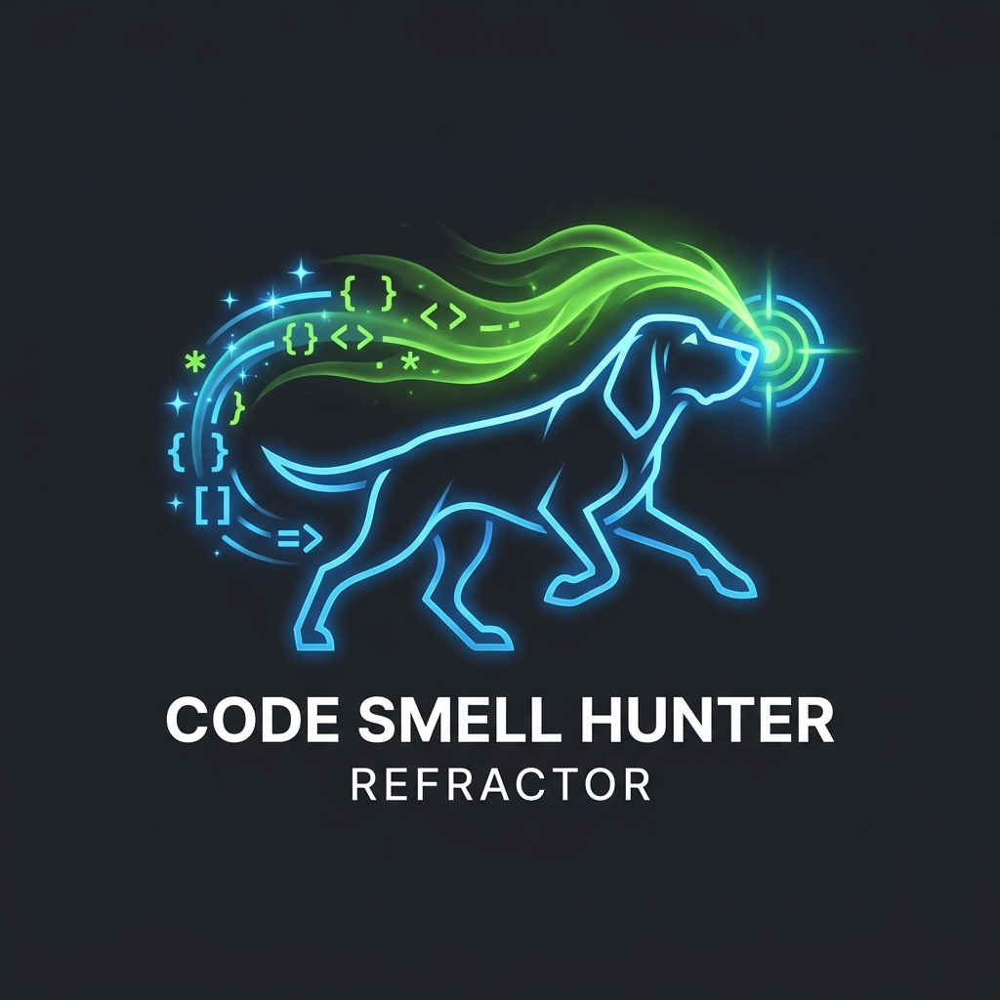

<p align="center">
  
</p>

<h1 align="center">Code Smell Hunter & Refactor</h1>

<p align="center">
  <b>Systematic Anti-Pattern Auditing, Technical Debt Elimination & Precision Refactoring for Google Antigravity</b>
</p>

---

## Overview

AI code generators often write code that works and passes tests, but is bloated with **technical debt**—sprawling 100-line functions, tangled dependencies, feature envy, and brittle switch statements that resist future modification.

**Code Smell Hunter** transforms Antigravity into a seasoned software architect:
1. **5 Martin Fowler Taxonomy Scanners**: Pinpoints Bloaters, Object-Orientation Abusers, Change Preventers, Dispensables, and Couplers.
2. **Behavior-Preserving Refactoring Recipes**: Maps each identified smell to proven transformations (Extract Method, Guard Clauses, Strategy Pattern, Hide Delegate).
3. **Strict Baseline Testing**: Enforces a zero-regression rule by writing safety characterization tests before touching production code.
4. **Antigravity Multi-Agent Audit**: Uses `invoke_subagent` with `pro` reasoning models to independently review diffs and catch speculative over-engineering.

---

## 5 Code Smell Categories

| Category | Typical Anti-Patterns | Proven Refactoring Transformation |
| :--- | :--- | :--- |
| **1. Bloaters** | Long Method, God Class, Long Parameter List, Primitive Obsession | `Extract Method`, `Extract Class`, `Introduce Parameter Object` |
| **2. OO Abusers** | Switch Statements, Nested If-Else, Refused Bequest, Temporary Fields | `Replace Conditional with Polymorphism`, `Replace Inheritance with Delegation` |
| **3. Change Preventers** | Divergent Change, Shotgun Surgery | `Move Method`, `Move Field`, `Inline Class` |
| **4. Dispensables** | Duplicate Code (DRY), Dead Code, Speculative Generality | `Form Template Method`, `Collapse Hierarchy`, prune unused dead code |
| **5. Couplers** | Feature Envy, Inappropriate Intimacy, Message Chains (Demeter) | `Move Method`, `Hide Delegate`, decouple module boundaries |

---

## How to Use

### Trigger Commands
* `/smell [file or module path]`
* `/refactor [function or class name]`
* `audit code smells for: [file]`
* `clean up technical debt in this repo`

#### Example Prompt:
> `/smell Audit src/services/billing.ts for code smells. Output the severity table in Artifacts, and safely refactor the long processPayment method into clean single-responsibility functions.`

---

## Installation

Clone this repository into your Antigravity plugins directory:

```bash
git clone https://github.com/davigmacode/code-smell-hunter.git ~/.gemini/config/plugins/code-smell-hunter
```

Restart Google Antigravity or your IDE to activate the plugin.

---

## Directory Structure

```text
code-smell-hunter/
├── assets/
│   └── logo.png              # Bloodhound code radar emblem
├── skills/
│   └── code-smell-hunter/
│       └── SKILL.md          # Taxonomy checklists, refactoring recipes & subagent protocols
├── plugin.json               # Antigravity plugin manifest
└── README.md                 # Documentation
```

---

## License

MIT © [Irfan Vigma Taufik (davigmacode)](https://github.com/davigmacode)
